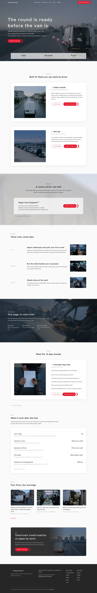

# Yukisaki Route

Yukisaki Route is a quiet, documentary-style WordPress theme designed specifically for regional courier dispatch desks and small delivery fleets. Built for clarity and speed, it provides white dossier cards, frosted statement panels, and road-tested round sheets that bring calm order to morning deliveries. Ideal for regional logistics businesses operating between 3 and 25 vans that value dependable workflows and paper-first dispatch.

Signature techniques: white dossier cards with a 470px square photograph and paired outline + chevron-tail buttons (after a logistics-software reference); a frosted translucent statement panel over a blurred photograph; a double-chevron tail call to action in red; a grey Latin eyebrow over every heading. Scroll effects: sp-parallax (hero photograph and the round-sheet band), sp-reveal--zoom (dossier cards), sp-stagger + sp-reveal--up (week rows and stories). The route line over the hero photograph draws itself on load with a CSS keyframe that stops under reduced motion.

See brand.md and brand/design-spec.md for the copy and the measured reference values.

## Pages

Home (a single long conversion page with an anchor menu) plus short inner pages (How it works, The Round Sheet, Trial, Pricing, Stories, About, FAQ, Field Notes, Contact, Waitlist, Privacy, Terms, Thanks). Full inner pages and the zh-TW, ja, fr and de translations follow in the next release.

## Photography

Thirteen low-key, neutral-grey documentary photographs on the home page, none repeated: a dawn depot lane with a parked white van, an empty-road van from behind, a frosted canopy ground, a dashboard round sheet, dispatch desk, driver, tailgate pair, overhead hands, old-town street, pharmacy hand-over, white flower crates and tail-lights leaving a yard. Generated for this theme; no people, brands or text are real.

<!-- screenshots:start -->
## Screenshots

<table>
<tr>
<td valign="top"></td>
<td valign="top"></td>
</tr>
</table>

- How it works: [desktop](screenshots/how-it-works-desktop.webp) · [mobile](screenshots/how-it-works-mobile.webp)
- Round sheet: [desktop](screenshots/round-sheet-desktop.webp) · [mobile](screenshots/round-sheet-mobile.webp)
- Trial: [desktop](screenshots/trial-desktop.webp) · [mobile](screenshots/trial-mobile.webp)
- Pricing: [desktop](screenshots/pricing-desktop.webp) · [mobile](screenshots/pricing-mobile.webp)
- Stories: [desktop](screenshots/stories-desktop.webp) · [mobile](screenshots/stories-mobile.webp)
- About: [desktop](screenshots/about-desktop.webp) · [mobile](screenshots/about-mobile.webp)
- Faq: [desktop](screenshots/faq-desktop.webp) · [mobile](screenshots/faq-mobile.webp)
- News: [desktop](screenshots/news-desktop.webp) · [mobile](screenshots/news-mobile.webp)
- Field notes: [desktop](screenshots/field-notes-desktop.webp) · [mobile](screenshots/field-notes-mobile.webp)
- Article: [desktop](screenshots/article-desktop.webp) · [mobile](screenshots/article-mobile.webp)
- Category: [desktop](screenshots/category-desktop.webp) · [mobile](screenshots/category-mobile.webp)
- Tag: [desktop](screenshots/tag-desktop.webp) · [mobile](screenshots/tag-mobile.webp)
- Newsletter: [desktop](screenshots/newsletter-desktop.webp) · [mobile](screenshots/newsletter-mobile.webp)
- Contact: [desktop](screenshots/contact-desktop.webp) · [mobile](screenshots/contact-mobile.webp)
- Other languages (home page): [zh-TW](screenshots/zh-TW/home-desktop.webp) · [ja](screenshots/ja/home-desktop.webp) · [fr](screenshots/fr/home-desktop.webp) · [de](screenshots/de/home-desktop.webp)
<!-- screenshots:end -->
